# Agentic maintenance crew

A small team of [Kiro Crew](https://github.com/kirodotdev/KiroCrew) agents that does the recurring maintenance of this repository, or of your fork of it: it triages dependency pull requests, discovers and risk-rates new blockchain client releases, prepares version-bump branches, and smoke-tests risky upgrades on a test AWS account.

The crew reads and analyses on its own. It never decides. Every change to AWS or to the repository waits for your explicit approval, and every change on GitHub (approve, merge, close, open a PR) is your own click, prepared and recorded by the crew. The crew's GitHub access is read-only.

It reuses the GenAI workflows this repository already ships (`docs/ageai-*.md`) and adds five agent definitions, five skills, two prompts, a setup procedure and this page. No scripts, no new dependencies, no state in the repository.

## Before you start

**What it costs.** A round takes about an hour of your attention: a few minutes while the crew collects, then the Decision Table, then the GitHub clicks and approval prompts for what you ticked. A smoke test runs a testnet node in your test account for up to 12 hours by default (longer for snapshot-based blueprints such as Base, BNB and Bitcoin); the blueprint README's cost table tells you the hourly price before you approve it.

**What you need.**

- Kiro Crew 0.11 or later and Kiro CLI, on a machine where `kirocrew` on `PATH` serves the dashboard's data home.
- Node.js 20+, AWS CLI v2 and git on `PATH` (the gateway's `PATH` too, if Kiro Crew runs as a service).
- The [github-mcp-server](https://github.com/github/github-mcp-server) v2.0.3 native binary on `PATH`, verified against the release's checksums file.
- A GitHub account for a **read-only** token (your own is fine; see "Identity and token").
- A separate **test AWS account** with a named CLI profile, CDK-bootstrapped in your region, ideally with an AWS Budgets alarm.
- Branch protection on `main`: pull request required, one approving review, required status checks `Build, test, and validate CDK synthesis` and `Analyze TypeScript`, linear history.
- Your clone and the three worktrees setup creates must lie under a directory in Kiro Crew's `agent.subagent_cwd_allowed_roots` (default `~/workspace` and siblings).

## What a round looks like



You open the Maintainer Lead's chat and send `@maintenance-round`, optionally with a scope: `PRs only`, `versions only`, a blueprint name, or `shadow`. The Lead then:

1. **Collects**, in two parallel worker sessions. PR Triage classifies every open pull request. Version Scout compares each blueprint's pinned client versions with upstream releases and rates each possible bump Low, Medium or High.
2. **Presents one Decision Table** as a multi-select card. Each row is a recommendation with its reason: merge this Dependabot PR, close that failing one, open a PR for this patch bump, smoke-test that major bump, fix this defect the last smoke test exposed, redirect this community blueprint PR to the Community Catalog, destroy that leftover test stack. You tick what you approve. Unticked is rejected, and so is any answer that is not a clear yes.
3. **Executes only ticked rows**, one at a time.
   - **GitHub actions are yours.** For each ticked PR row the Lead re-checks the PR, posts the link with the action and any drafted comment, and you approve, merge, close or comment in the GitHub UI. For a pushed bump branch it posts the compare link and you open the PR. The Lead reads the result back and records it.
   - **Repository and AWS work runs in worker sessions.** Version Scout prepares a bump branch in its own worktree, validates it (`npm run build`, `npm run test`, `npx cdk synth`) and pushes it: Low risk in one step, Medium and High after a second confirmation with the changed-file list in front of you. The Fixer does the same for one finding at a time: it confirms the finding against the code, writes a test that fails, makes the smallest change that passes it, validates, and pushes after your second confirmation; you open the PR. The Smoke Tester deploys a test stack after you confirm the stack, network, instance type and cost. Each push and deploy raises its own approval prompt in the worker session, so a misread card cannot write without a second click.
4. **Checks on the running node.** After a deploy, the Lead registers a small reminder job (one prompt in the Lead's chat) that wakes 10 minutes after the stack is up and every 15 minutes after that. Each wake only tells the Lead a check is due; the Lead then asks the Smoke Tester session that deployed the stack to run the healthcheck, and that session's AWS reads prompt in its tab for you to allow. No crew session runs unattended. A check ends with passed, failed or in progress; the test ends at the first conclusive verdict or at the deadline you approved (12 hours by default, a cost cap). The Lead then proposes destroying the stack and removes the reminder. **Destroying the stack is yours**: Kiro Crew's built-in rule refuses `aws cloudformation delete-stack` from every agent shell, so you run the command the Lead posts and it confirms `DELETE_COMPLETE`. If the bump went in as a draft PR and the test passed, the Lead asks you to mark it ready. Keep the Lead's chat and the deploy session open while a smoke test runs.
5. **Writes a private Round Report** in a directory you chose at setup: every recommendation, your decision, what was executed, links, stacks still running. Reports stay out of the repository because they describe unapplied security releases, failed upgrades and your test infrastructure.

Rounds start only when you ask. Nothing is scheduled except the Check-In after a deploy you approved.

## What the crew does

| Agent | Does | Writes |
|---|---|---|
| Maintainer Lead | Runs the round, dispatches workers, presents the Decision Table, hands GitHub actions to you | The Round Report; the Check-In cron job |
| PR Triage | Classifies PRs, writes review briefs and drafted replies | Nothing |
| Version Scout | Runs `docs/ageai-version-update-prompt.md` Steps 1–5 in its own worktree | Files under `blueprints/<protocol>/` and `CHANGELOG.md`; `git push` of the bump branch |
| Smoke Tester | Deploys a bump to the test account, runs the healthcheck as the Check-In, troubleshoots | `cdk deploy`; the smoke worktree's `.env` and CDK output. Destroys are yours |
| Fixer | Turns one finding from a round (a script that fails silently, a stale sample, a missing check) into a fix branch with a regression test | Files under `blueprints/`, `assets/`, `lib/`, `test/`, `docs/` and `CHANGELOG.md` in its own worktree; `git push` of the fix branch after your second confirmation. Never CI, agent instructions or dependencies: those fixes come back to you as a write-up |

Agent specs live in `.kiro/agents/bnr-*.json`, skills in `.kiro/skills/bnr-*/SKILL.md`.

The crew never writes to GitHub through the API (every agent's GitHub MCP server runs read-only), never posts comments or reviews (it drafts, you post), and never runs code from a fork on your machine (CI is the sandbox).

### How a pull request is classified

- **Dependabot**, both required checks green, no failed check, mergeable: merge candidate. You approve and squash-merge; the brief gives the commit subject. A PR under `.github/workflows/` is flagged as changing CI itself.
- **Dependabot with a failing check**: the failing step and probable cause, plus a proposal (close with a drafted comment, wait for upstream, or a fix you make).
- **A collaborator's PR**: never a merge candidate; checks, mergeability, risk tier and sensitive-path flags.
- **A community PR**: never a merge candidate; a review brief (author association, template checklist, linked issue, Conventional Commit title, checks, sensitive paths) and a drafted reply. A PR adding a directory under `blueprints/` is recommended for redirection to the Community Catalog, per `CONTRIBUTING.md`.
- **Anything touching `.kiro/agents/`, `.kiro/skills/`, `.kiro/prompts/` or `docs/ageai-*.md`**: human review whoever opened it. These files are instructions to AI agents.

### How a version bump is rated

| Risk | When | What the crew proposes |
|---|---|---|
| Low | patch release, no flag, config or storage change | push the branch in one step; you open the PR |
| Medium | minor release, changed flags or defaults, linked execution/consensus bump | second confirmation before the push; smoke test optional, run against `main` after you merge |
| High | major release, release-line change, database migration, "new node required", hard-fork deadline, any compatibility concern | as Medium, plus a smoke test. Default **"PR, then smoke"** (you merge, the crew smokes `main`); for a change you would not want on `main` untested, **"Draft PR + smoke"** (the branch is smoked first, you mark the draft ready after it passes) |

Security releases are flagged urgent whatever their risk. A pinned pre-release in a shipped configuration is flagged for review.

## How approval is enforced

Telling an agent to ask is one layer. The crew stacks seven:

| Layer | What it stops |
|---|---|
| Instructions and the Decision Table | ordinary mistakes |
| Kiro permission rules in each agent spec: reads allowed, every write `ask`, file writes scoped to each role's directory, `gh` and unneeded commands denied | unintended writes, including from a prompt injection in a PR or release note |
| `--read-only` on every agent's GitHub MCP server | any GitHub write through MCP, whatever a rule or prompt says |
| Denied commands on your machine for the `gh` merge, review, close, ready and `api -X` subcommands | the crew acting under your own `gh` login |
| A read-only GitHub token scoped to one repository | the token being worth stealing |
| Branch protection on `main`; merges are your clicks | unreviewed or red merges |
| A separate test AWS account, checked by account ID before every deploy | impact on anything that matters |

Three rules keep those layers intact:

- **Run the Lead's chat in approval mode Normal, never Trust or YOLO.** Dispatched workers inherit the chat's posture; in Trust every `ask` is answered yes silently, in every worker. The Lead confirms the mode at the start of each round.
- **Answer worker prompts with Allow or Reject, never Trust.** Trust switches that worker to auto-approve for the rest of its work, including a later push or deploy.
- **Prompts appear in the worker session, not in the Lead's chat**, and expire after `agent.tool_approval_timeout_secs` (600 s by default). The Lead posts the worker's link with every write item; keep it open, or raise the timeout for the day.

**Which Kiro backend you run matters for prompt count, not for safety.** `agent.acp_backend` empty (the default) is KAS; `kiro` is kiro-cli. Deny and ask rules behave the same on both. kiro-cli honours the `allow` rules for local git, npm and in-scope file writes, so a bump costs one or two prompts and a round runs by itself up to the next gate. KAS withholds those allows, so each such call prompts in the worker tab (10 to 15 per bump) and the round waits for you at every one. Start on the default; for regular rounds `kirocrew config set agent.acp_backend kiro` and a restart switches, and back again the same way. Do not work around KAS prompts with Trust.

The five agents are plain Kiro agent templates. Do not register them as Kiro Crew crewmates: crewmate chats run on a shared conductor that ignores a template's permission rules, and the Lead could then no longer dispatch the others.

## Identity and token

**The crew's identity** is the GitHub account behind its read-only token and behind the Git credential `git push` uses for bump branches. Because the crew never approves, merges or opens PRs, this can be your own account (`crew_identity: maintainer`). A dedicated machine account (`crew_identity: bot`) gives a separate audit trail for pushed branches; it needs a seat and may be restricted by your organisation. Either way you open the PR from the pushed branch, so it carries your name and needs another collaborator's approval.

**The approving identity** is you, in the GitHub UI. Nothing in the crew can approve or merge, so "Do not allow bypassing the above settings" on `main` costs nothing to enable; the upstream repository runs with it on.

**The token** is read-only: a fine-grained personal access token for this repository only, expiry 90 days or less, with Metadata, Contents, Pull requests, Actions and Commit statuses at **Read**, nothing else. If your organisation has not enabled fine-grained tokens, a classic token with `public_repo` (or `repo` for a private fork) works; the read-only server flag means a broader scope cannot be used for writes. Do not use a token from `gh auth token` or Git Credential Manager: those are OAuth App tokens, which many organisations (the upstream `aws-samples` among them) reject for anything but public reads.

Store it in Kiro Crew's secrets vault (Settings → Secrets) as **`BNR_CREW_GITHUB_TOKEN`**. The agent specs reference it as `secret://BNR_CREW_GITHUB_TOKEN`; the gateway resolves it when it starts the server, and no agent, file or chat ever sees the value. Never authenticate `gh` with it.

## Setup

Run `@setup-maintenance-crew` from Kiro with the clone as project directory. It detects what is already done, asks before every write, verifies the result and can tear everything down. The procedure it follows is `docs/ageai-setup-maintenance-crew-prompt.md`, which also covers the platform details (Windows line endings for shell scripts, Git Credential Manager, leftover crewmates). What ends up where:

1. The token in the vault as `BNR_CREW_GITHUB_TOKEN`.
2. `github-mcp-server` on `PATH`.
3. Copies of `.kiro/agents/bnr-*.json` and `.kiro/skills/bnr-*/` in `~/.kiro/agents/` and `~/.kiro/skills/`. Kiro Crew resolves the agents the Lead dispatches, and the headless Check-In, from there. Re-copy after a `git pull` that changes either directory.
4. Three worktrees next to the clone, `bnr-scout`, `bnr-smoke` and `bnr-fixer`, each with `npm ci`. Version Scout, the Smoke Tester and the Fixer work there, never in your clone.
5. Project trust for the clone and each worktree when the dashboard asks (skill trust and MCP trust are separate prompts).
6. One denied-command rule (Settings → Security): `gh\s+(pr\s+(merge|review|close|ready)|api\s+.*(-X|--method)\b)`.
7. A Git credential for `github.com` stored once with `git credential-manager github login`, and `credential.interactive=false`, so a worker's `git push` either works or fails fast.
8. The steering file `~/.kiro/steering/bnr-crew.md`, loaded by every Kiro session on the machine (it holds no secret):
   ```markdown
   ---
   inclusion: always
   name: bnr-crew
   description: Local settings for the AWS Blockchain Node Runners maintenance crew
   ---
   - aws_profile: <your test-account profile>
   - test_account_id: <12-digit account id>
   - crew_identity: bot | maintainer
   - clone_path: <absolute path of the clone>
   - scout_worktree_path: <absolute path of bnr-scout>
   - smoke_worktree_path: <absolute path of bnr-smoke>
   - fixer_worktree_path: <absolute path of bnr-fixer>
   - round_reports_path: <absolute path of a directory outside every checkout>
   - clone_folder: bnr-clone
   - scout_folder: bnr-scout
   - smoke_folder: bnr-smoke
   - fixer_folder: bnr-fixer
   ```
9. Four sidebar folders in the dashboard (`bnr-clone`, `bnr-scout`, `bnr-smoke`, `bnr-fixer`), each with its project directory set. A worker session takes its working directory from the folder the Lead files it into.
10. The Lead's chat: new chat → Custom agents → `bnr-maintainer-lead`, project directory the clone, approval mode Normal.

**Verify** in the Lead's chat: ask it to call `get_me` (the login must be the crew's account; this also proves the binary, the vault reference and the token) and to load its skill with `skill_search` (`bnr-maintenance-round` must be found). Then `aws sts get-caller-identity --profile <aws_profile>` must return `test_account_id`, and `gh pr merge` in any chat must be refused.

**Teardown** is a section of the same prompt; it removes every artifact listed above and nothing in the repository.

## The first rounds

Run two **shadow rounds** first (`@maintenance-round shadow`): the crew produces Decision Tables, you act by hand, and the Round Report records where you agreed. Every report shows the running agreement rate. When you are satisfied, run full rounds; the only difference is that bumps and smoke tests are dispatched after your tick. PR actions are your clicks in both kinds of round.

Round Reports are one file per round in `round_reports_path`, named `<YYYY-MM-DD>-<short-sha>.md`: base commit, scope, every item with recommendation, decision, execution and link; smoke tests still running; crew stacks still present; rejected items; notes for the next round. No secrets, account IDs or local paths.

The crew runs the discovery and analysis steps of `docs/ageai-version-update-prompt.md` unattended inside a round and stops at that workflow's approval gate, which the Decision Table replaces. The deploy, healthcheck and troubleshooting workflows are used unchanged.
